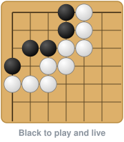

## Hi, I'm Ian /ˈiː.ən ˈɡɪ.fəɹd/

I study Computer Science and AI at McGill, with a minor in Linguistics. My research so far looks at how models learn and represent structure, mostly in language, and I build the software those experiments run on: annotation platforms, benchmarks and data pipelines. I'm interested in ML more broadly too, including vision, reasoning and planning. In my free time, I train my own planning and search on a Go board.

Most of my experience is in research labs, but I'm just as interested in industry roles where I can build and ship ML systems.

**Looking for Summer 2027 internships** in ML research, ML engineering, research engineering, and software engineering.

**Co-first-authored paper at [CoNLL 2026](https://aclanthology.org/2026.conll-main.40/)** · Research at Mila, MCQLL and McGill AI Lab · Full-stack tools used by lab researchers

[Website](https://iangif.github.io) · [LinkedIn](https://linkedin.com/in/ian-gifford88) · [Email](mailto:iangiffordwork@gmail.com)

&nbsp;&nbsp;&nbsp;&nbsp;&nbsp;&nbsp;&nbsp;&nbsp;&nbsp;&nbsp;&nbsp;&nbsp;&nbsp;&nbsp;&nbsp;'&nbsp;&nbsp;&nbsp;&nbsp;&nbsp;&nbsp;&nbsp;&nbsp;&nbsp;&nbsp;&nbsp;*&nbsp;&nbsp;&nbsp;&nbsp;&nbsp;&nbsp;&nbsp;&nbsp;&nbsp;&nbsp;&nbsp;&nbsp;&nbsp;+&nbsp;&nbsp;&nbsp;&nbsp;&nbsp;&nbsp;.&nbsp;&nbsp;&nbsp;&nbsp;&nbsp;&nbsp;&nbsp;*&nbsp;&nbsp;&nbsp;&nbsp;&nbsp;&nbsp;&nbsp;&nbsp;&nbsp;&nbsp;&nbsp;&nbsp;&nbsp;+&nbsp;&nbsp;&nbsp;&nbsp;&nbsp;&nbsp;&nbsp;&nbsp;&nbsp;&nbsp;&nbsp;&nbsp;.&nbsp;&nbsp;&nbsp;&nbsp;&nbsp;&nbsp;&nbsp;&nbsp;&nbsp;&nbsp;&nbsp;&nbsp;&nbsp;&nbsp;&nbsp;+&nbsp;&nbsp;&nbsp;&nbsp;&nbsp;&nbsp;+&nbsp;&nbsp;&nbsp;&nbsp;&nbsp;&nbsp;&nbsp;&nbsp;&nbsp;&nbsp;&nbsp;&nbsp;'&nbsp;&nbsp;&nbsp;&nbsp;&nbsp;&nbsp;&nbsp;&nbsp;.&nbsp;&nbsp;&nbsp;&nbsp;&nbsp;&nbsp;&nbsp;&nbsp;.&nbsp;&nbsp;&nbsp;&nbsp;&nbsp;&nbsp;&nbsp;&nbsp;+&nbsp;&nbsp;&nbsp;&nbsp;&nbsp;&nbsp;&nbsp;&nbsp;. &nbsp;&nbsp;&nbsp;&nbsp;&nbsp;&nbsp;&nbsp;&nbsp;&nbsp;&nbsp;&nbsp;*&nbsp;&nbsp;&nbsp;&nbsp;&nbsp;&nbsp;&nbsp;&nbsp;&nbsp;+&nbsp;&nbsp;&nbsp;&nbsp;&nbsp;&nbsp;&nbsp;&nbsp;.&nbsp;&nbsp;&nbsp;&nbsp;&nbsp;&nbsp;&nbsp;&nbsp;&nbsp;&nbsp;*&nbsp;&nbsp;&nbsp;&nbsp;&nbsp;&nbsp;&nbsp;&nbsp;&nbsp;+&nbsp;&nbsp;&nbsp;&nbsp;&nbsp;&nbsp;&nbsp;&nbsp;+&nbsp;&nbsp;&nbsp;&nbsp;&nbsp;&nbsp;&nbsp;&nbsp;&nbsp;&nbsp;&nbsp;&nbsp;'&nbsp;&nbsp;&nbsp;&nbsp;&nbsp;&nbsp;*&nbsp;&nbsp;&nbsp;&nbsp;&nbsp;&nbsp;&nbsp;&nbsp;&nbsp;&nbsp;&nbsp;&nbsp;.&nbsp;&nbsp;&nbsp;&nbsp;&nbsp;&nbsp;&nbsp;&nbsp;'&nbsp;&nbsp;&nbsp;&nbsp;&nbsp;&nbsp;&nbsp;*&nbsp;&nbsp;&nbsp;&nbsp;&nbsp;&nbsp;&nbsp;&nbsp;&nbsp;&nbsp;*&nbsp;&nbsp;&nbsp;&nbsp;&nbsp;&nbsp;&nbsp;&nbsp;&nbsp;&nbsp;&nbsp;&nbsp;&nbsp;&nbsp;&nbsp;*&nbsp;&nbsp;&nbsp;&nbsp;&nbsp;&nbsp;&nbsp;'

### MCQLL: research infrastructure
*Software Engineering Research Assistant, Montréal Computational & Quantitative Linguistics Lab · 2026–present*

I build the lab's pipeline for a hand-verified formant dataset in English, French, Japanese and Uyghur, from annotation to benchmarking.

<table>
<tr>
<td width="55%"></td>
<td>

**[formant-annotation-tool](https://github.com/iangif/formant-annotation-tool)** 
A keyboard-first FastAPI and JavaScript app, plus server sync, reconciliation, and adjudication. It replaced a manual workflow: **5,000+ tokens** labelled, and batch management cut from **~40 to ~10 hours**.

**[formant-benchmark](https://github.com/iangif/formant-benchmark)** 
An extensible benchmark for formant trackers, currently comparing **3 trackers on 3 corpora in 4 languages**. Datasets and trackers plug in through adapters, runs are cached and reproducible, and evaluation is frame-level.

</td>
</tr>
</table>

### McGill AI Lab: NLP research
*Student Researcher → Team Lead · 2025–present*

- **[age-of-acquisition](https://github.com/McGill-AI-Lab/age-of-acquisition)**: Does learning words in the order children do shape word embeddings? Built on an ≈18M-sentence curriculum pipeline and 40+ Word2Vec experiments. AoA-ordered training predicts human acquisition norms with ρ = 0.93, compared with 0.56 for shuffled training. [Paper, CoNLL 2026 →](https://aclanthology.org/2026.conll-main.40/)
   Presented at the Cognitive Science Undergraduate Research Forum (CogSURF) · McGill Canadian Conference for Linguistics Undergraduates (MCCLU) · McGill Undergraduate Science Showcase
- **Diffusion LM probing** *(in progress)*: I lead a team of 4 tracing how syntactic and semantic knowledge emerges during diffusion language model denoising, using linear probes. Code coming soon.

### Mila: interpretability
*Research Intern · 2026–present*

- **Induced grammar categories** *(in progress)*: An analysis framework for the categories learned by visually grounded grammar induction models. It covers 300K+ tokens and ~10 models, and compares lexical and contextual feature profiles across models. It replaces manual category-by-category analysis and works across model families.

**Also:** [dog vocalization classifier](https://github.com/sarayangrh/Cross-Species-Translation) (CNNs, 83% breed accuracy) · [pronunciation tutor](https://github.com/iangif/g2p-pronunciation-tutor) (G2P + indexed native audio)

&nbsp;&nbsp;&nbsp;&nbsp;&nbsp;&nbsp;&nbsp;&nbsp;&nbsp;&nbsp;&nbsp;&nbsp;&nbsp;&nbsp;&nbsp;'&nbsp;&nbsp;&nbsp;&nbsp;&nbsp;&nbsp;&nbsp;&nbsp;&nbsp;&nbsp;&nbsp;*&nbsp;&nbsp;&nbsp;&nbsp;&nbsp;&nbsp;&nbsp;&nbsp;&nbsp;&nbsp;&nbsp;&nbsp;&nbsp;+&nbsp;&nbsp;&nbsp;&nbsp;&nbsp;&nbsp;.&nbsp;&nbsp;&nbsp;&nbsp;&nbsp;&nbsp;&nbsp;*&nbsp;&nbsp;&nbsp;&nbsp;&nbsp;&nbsp;&nbsp;&nbsp;&nbsp;&nbsp;&nbsp;&nbsp;&nbsp;+&nbsp;&nbsp;&nbsp;&nbsp;&nbsp;&nbsp;&nbsp;&nbsp;&nbsp;&nbsp;&nbsp;&nbsp;.&nbsp;&nbsp;&nbsp;&nbsp;&nbsp;&nbsp;&nbsp;&nbsp;&nbsp;&nbsp;&nbsp;&nbsp;&nbsp;&nbsp;&nbsp;+&nbsp;&nbsp;&nbsp;&nbsp;&nbsp;&nbsp;+&nbsp;&nbsp;&nbsp;&nbsp;&nbsp;&nbsp;&nbsp;&nbsp;&nbsp;&nbsp;&nbsp;&nbsp;'&nbsp;&nbsp;&nbsp;&nbsp;&nbsp;&nbsp;&nbsp;&nbsp;.&nbsp;&nbsp;&nbsp;&nbsp;&nbsp;&nbsp;&nbsp;&nbsp;.&nbsp;&nbsp;&nbsp;&nbsp;&nbsp;&nbsp;&nbsp;&nbsp;+&nbsp;&nbsp;&nbsp;&nbsp;&nbsp;&nbsp;&nbsp;&nbsp;. &nbsp;&nbsp;&nbsp;&nbsp;&nbsp;&nbsp;&nbsp;&nbsp;&nbsp;&nbsp;&nbsp;*&nbsp;&nbsp;&nbsp;&nbsp;&nbsp;&nbsp;&nbsp;&nbsp;&nbsp;+&nbsp;&nbsp;&nbsp;&nbsp;&nbsp;&nbsp;&nbsp;&nbsp;.&nbsp;&nbsp;&nbsp;&nbsp;&nbsp;&nbsp;&nbsp;&nbsp;&nbsp;&nbsp;*&nbsp;&nbsp;&nbsp;&nbsp;&nbsp;&nbsp;&nbsp;&nbsp;&nbsp;+&nbsp;&nbsp;&nbsp;&nbsp;&nbsp;&nbsp;&nbsp;&nbsp;+&nbsp;&nbsp;&nbsp;&nbsp;&nbsp;&nbsp;&nbsp;&nbsp;&nbsp;&nbsp;&nbsp;&nbsp;'&nbsp;&nbsp;&nbsp;&nbsp;&nbsp;&nbsp;*&nbsp;&nbsp;&nbsp;&nbsp;&nbsp;&nbsp;&nbsp;&nbsp;&nbsp;&nbsp;&nbsp;&nbsp;.&nbsp;&nbsp;&nbsp;&nbsp;&nbsp;&nbsp;&nbsp;&nbsp;'&nbsp;&nbsp;&nbsp;&nbsp;&nbsp;&nbsp;&nbsp;*&nbsp;&nbsp;&nbsp;&nbsp;&nbsp;&nbsp;&nbsp;&nbsp;&nbsp;&nbsp;*&nbsp;&nbsp;&nbsp;&nbsp;&nbsp;&nbsp;&nbsp;&nbsp;&nbsp;&nbsp;&nbsp;&nbsp;&nbsp;&nbsp;&nbsp;*&nbsp;&nbsp;&nbsp;&nbsp;&nbsp;&nbsp;&nbsp;'

### Outside the lab

- 🔭 **Astronomy**: published double-star measurements in the [*Journal of Double Star Observations*](https://www.jdso.org/volume20/number2/Gifford_242_249.pdf) (2024)
- 🦢 **Origami** · ⛸️ **Ice skating**
- 🐕 **Two black labs**

Python · PyTorch · FastAPI · SQLAlchemy · pandas / Parquet · JavaScript · SLURM · AWS
